<h1 align="center">flutter_table</h1>

<p align="center">
  <b>The two-dimensional table for Flutter.</b><br>
  Sticky headers · lazy rows · sorting · search · selection · resizable columns · 13 ready-made themes
</p>

<p align="center">
  
  
  
</p>

<p align="center">
  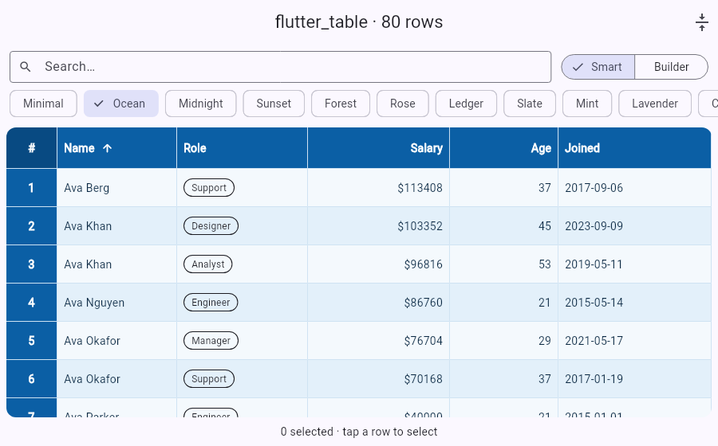
  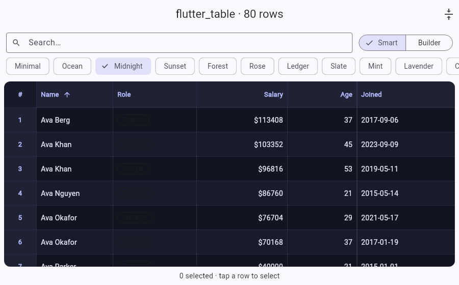
</p>

Scroll in any direction – the top row, the left column and the legend corner
always stay in view. Pick the level you need:

| You have…                       | Use                                   | Lines of code |
| ------------------------------- | ------------------------------------- | ------------- |
| A list of your own objects      | [`StickyDataTable<T>`](#smart-table)  | ~8            |
| Strings in a 2-D list           | [`StickyHeadersTable.text`](#from-strings) | ~5       |
| Fully custom cell widgets       | [`StickyHeadersTable`](#full-control-builders) | ~12  |

## Install

```yaml
dependencies:
  flutter_table:
    git:
      url: https://github.com/seena98/sticky-headers-table
```

```dart
import 'package:flutter_table/table_sticky_headers.dart';
```

Works on **Android, iOS, web, macOS, Windows and Linux**. Touch, mouse,
trackpad and stylus can all drag-scroll; scrollbars are optional.

## Smart table

Give it rows and columns – sorting, search, selection and column widths are
handled for you.

```dart
StickyDataTable<Employee>(
  rows: employees,
  columns: [
    StickyColumn(title: 'Name',   value: (e) => e.name),
    StickyColumn(title: 'Salary', value: (e) => e.salary, format: (v) => '\$$v'),
    StickyColumn(title: 'Joined', value: (e) => e.joined),
    StickyColumn(
      title: 'Role',
      value: (e) => e.role,
      cell: (context, e) => RoleBadge(e.role),   // any widget
    ),
  ],
  style: StickyTableStyle.ocean,
  searchQuery: query,          // live filter across all columns
  initialSortColumn: 0,
  selectable: true,
  onSelectionChanged: (rows) => setState(() => selected = rows),
)
```

* Tap a header to sort; numbers, text, dates and bools sort naturally
  (or pass `compare:`).
* Numbers are right-aligned automatically, widths are measured from the
  content, and columns stretch to fill wide screens (`stretchToFit`).
* `hiddenColumns: {2}` hides columns – build a column picker in a few lines.
* `stickyTableToCsv(columns, rows)` exports what you show.

## From strings

```dart
StickyHeadersTable.text(
  columnTitles: ['Name', 'Age'],
  rowTitles: ['#1', '#2'],
  data: [['Ann', '31'], ['Bob', '27']],
  style: StickyTableStyle.minimal,
)
```

## Full control (builders)

```dart
StickyHeadersTable(
  columnsLength: 20,
  rowsLength: 10000,                       // rows are built lazily
  columnsTitleBuilder: (j) => Text('Col $j'),
  rowsTitleBuilder: (i) => Text('Row $i'),
  contentCellBuilder: (j, i) => Text('$i, $j'),
  legendCell: const Text('Legend'),
  cellDimensions: CellDimensions.variableColumnWidth(
    columnWidths: widths, contentCellHeight: 48,
    stickyLegendWidth: 80, stickyLegendHeight: 52,
  ),
  cellAlignments: CellAlignments.uniform(Alignment.centerLeft),
)
```

## Themes

Every theme is a `const StickyTableStyle`. Use `StickyTableStyle.presets` for a
picker, or `StickyTableStyle.material(context)` to follow your app's
`ColorScheme`. Tweak any preset with `copyWith`.

| | | |
|:--:|:--:|:--:|
| 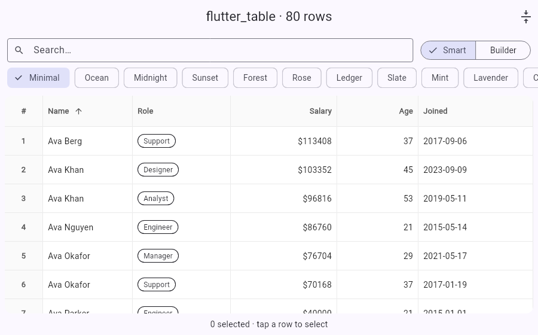 **minimal** |  **ocean** |  **midnight** |
| 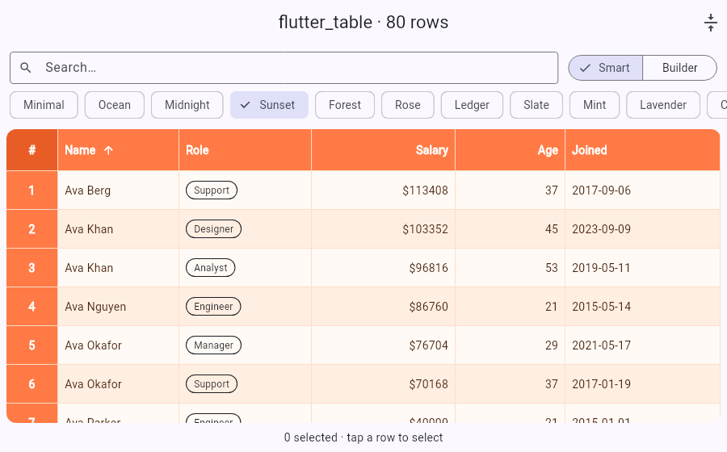 **sunset** | 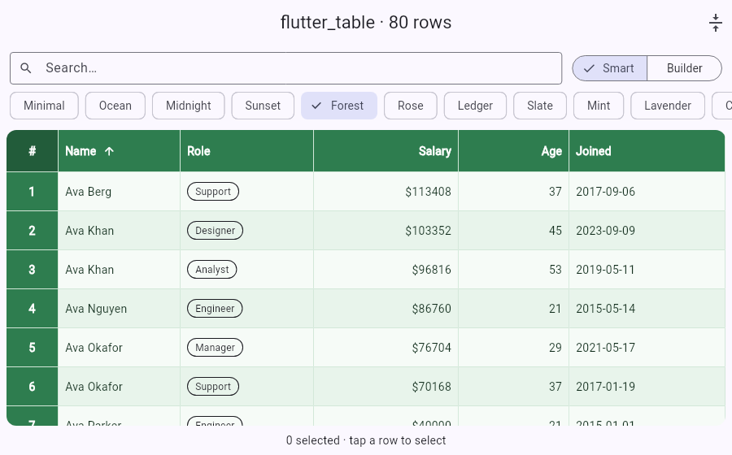 **forest** | 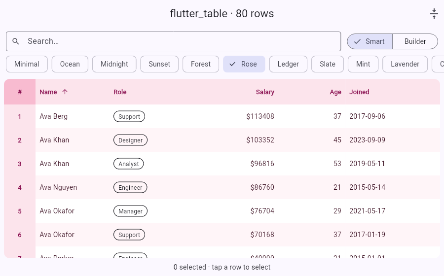 **rose** |
| 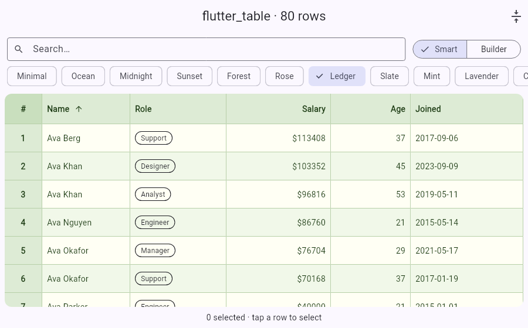 **ledger** | 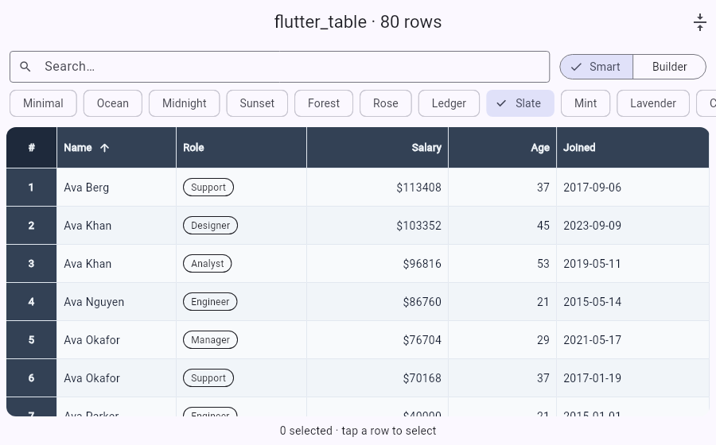 **slate** | 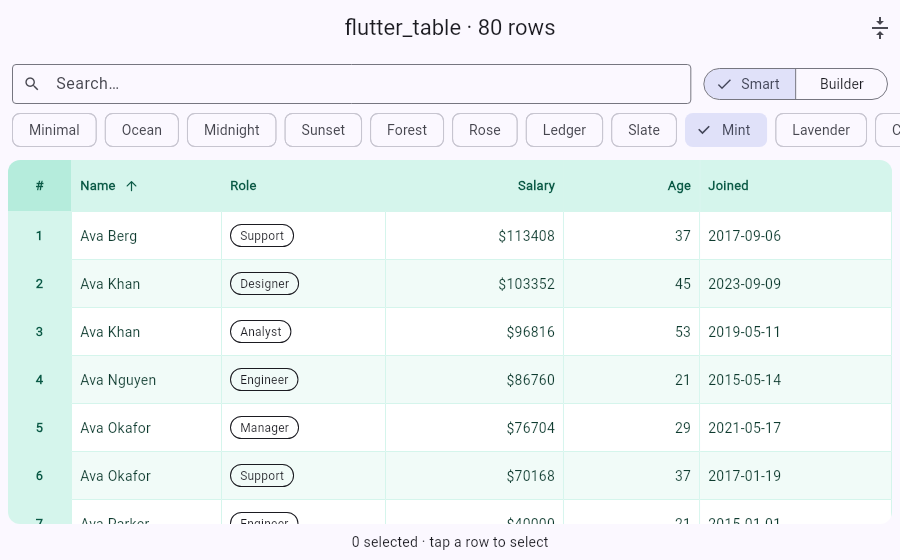 **mint** |
| 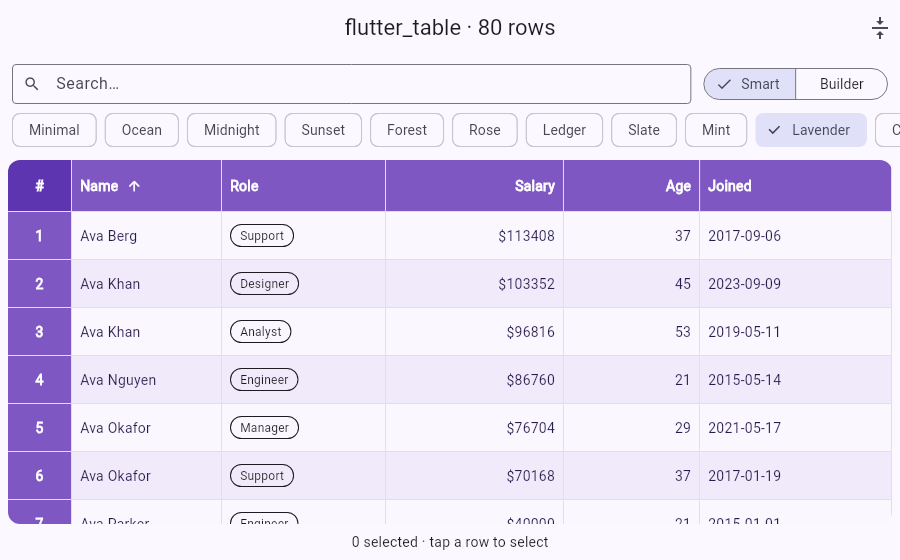 **lavender** | 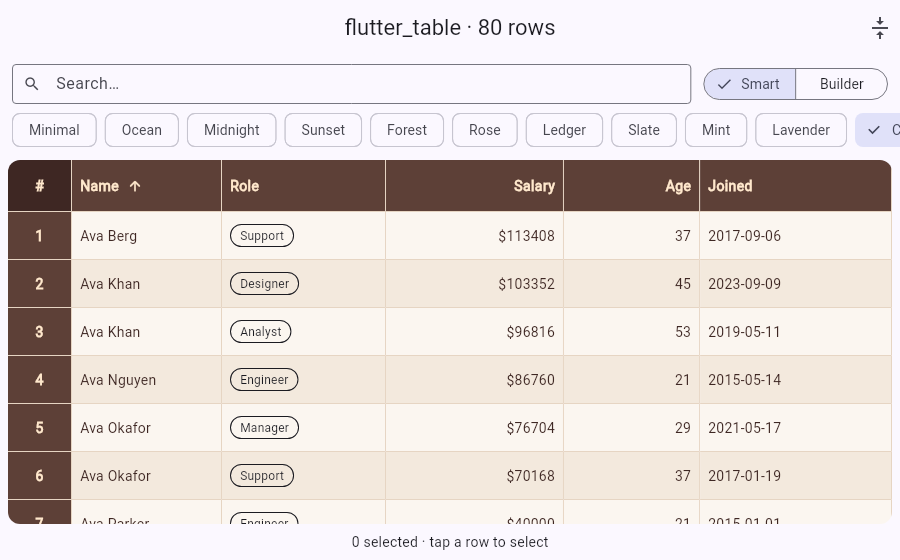 **coffee** | 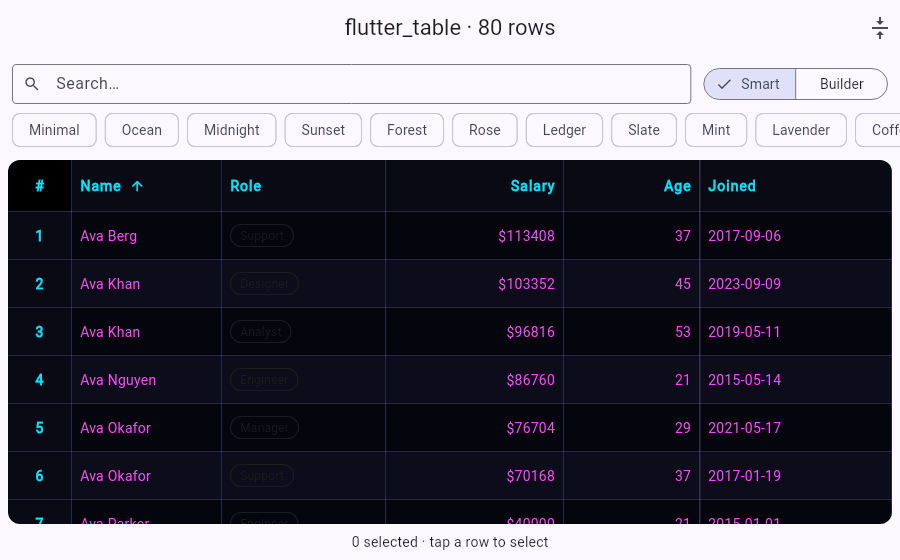 **neon** |
| 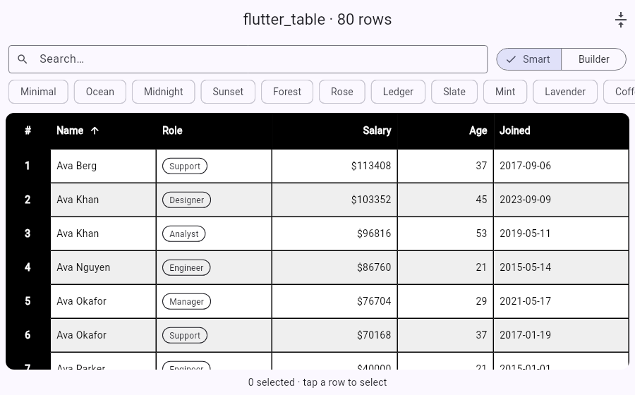 **contrast** | | |

Build your own:

```dart
const StickyTableStyle(
  headerColor: Color(0xFF1E2233),
  stripeColor: Color(0xFF181B2A),     // zebra rows
  hoverRowColor: Color(0xFF222640),   // mouse hover
  selectedRowColor: Color(0xFF2E3566),
  gridLineColor: Color(0xFF262A40),
  showScrollShadows: true,            // shadow appears under pinned headers
  headerTextStyle: TextStyle(fontWeight: FontWeight.w700),
)
```

## Everything `StickyHeadersTable` can do

| Feature | API |
| --- | --- |
| Lazy rows (10 000+ fine) | automatic |
| Fixed / per-column / per-row sizes | `CellDimensions.*` |
| Per-cell alignment | `CellAlignments.*` |
| Zebra, grid, hover, selection, scroll shadows | `style: StickyTableStyle(...)` |
| Selected rows | `selectedRows: {1, 4}` |
| Tap, double tap, long press, right click | `onContentCellPressed`, `onContentCellDoubleTap`, `onContentCellLongPress`, `onContentCellSecondaryTap` (gives position for context menus) |
| Header / legend taps | `onColumnTitlePressed`, `onRowTitlePressed`, `onStickyLegendPressed` |
| Sort arrows | `sortColumnIndex`, `sortAscending`, `onSort`, `isColumnSortable` |
| Drag-to-resize columns | `resizableColumns`, `minColumnWidth`, `onColumnResized` |
| Empty & loading states | `emptyBuilder`, `isLoading` |
| Infinite scroll | `onEndReached`, `endReachedThreshold` |
| Scroll programmatically | `StickyTableController` |
| Initial offset / scroll end callback | `initialScrollOffsetX/Y`, `onEndScrolling` |
| Scrollbars, mouse drag, physics | `showScrollbars`, `enableMouseDrag`, `physics` |
| Bring your own scroll controllers | `scrollControllers` |

### Controller

```dart
final controller = StickyTableController();

StickyHeadersTable(controller: controller, ...);

controller.scrollToRow(500, duration: const Duration(milliseconds: 400));
controller.scrollToColumn(8);
controller.scrollTo(x: 0, y: 0);
controller.offsetY;          // current position
controller.columnWidth(2);   // width after user resizing
```

### Infinite scroll

```dart
StickyDataTable<Item>(
  rows: items,
  columns: columns,
  isLoading: loading,
  onEndReached: loadNextPage,   // fires once per new page
)
```

## Migrating from 1.x

The builder API is unchanged. Differences:

* Requires Dart 3.5 / Flutter 3.27+.
* `onStickyLegendPressed` etc. are now nullable instead of no-op defaults.
* The initial scroll offset is applied once, not on every rebuild, and the
  table no longer loses its scroll position when the parent rebuilds.
* Default scroll controllers are owned and disposed by the table.

## Not included (yet)

Multiple frozen columns/rows, a pinned footer row, merged cells, keyboard
cell navigation. Issues and PRs welcome.

## Run the example

```sh
cd example
flutter run -d chrome   # or macos, windows, linux, an emulator...
```

The example is a theme gallery with live search, sorting, selection and
infinite scroll.

## Credits

This package is a fork of
[Alex Bacich's sticky-headers-table](https://github.com/AlexBacich/sticky-headers-table)
(itself derived from `table_sticky_headers`), maintained by
[seena98](https://github.com/seena98). The original project is no longer
updated, so this fork modernizes it and adds many new features. Thanks to
Alex Bacich and the original contributors.
